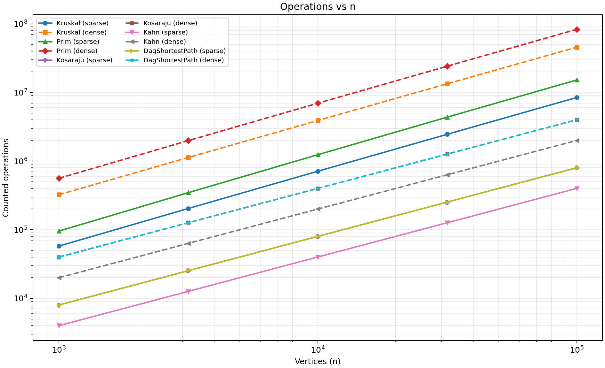
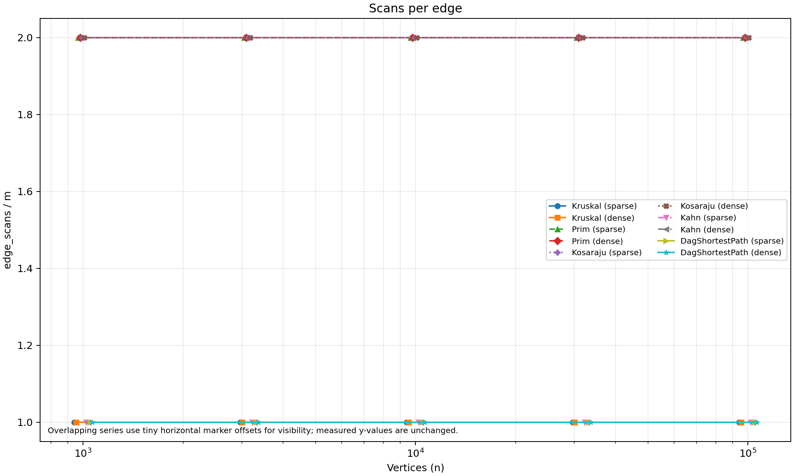
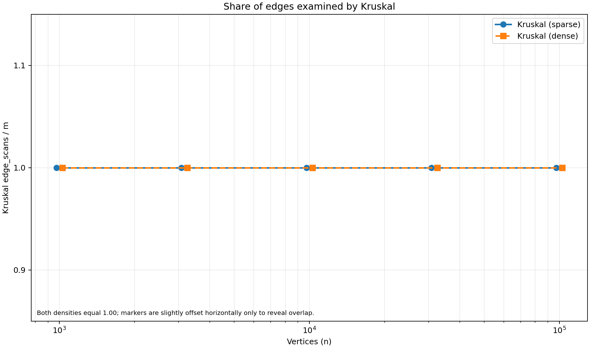

# Assignment 3 Report — City Network & Job Scheduler

**Scope:** DSU, minimum spanning forests, strongly connected components, topological ordering, DAG shortest paths and deterministic operation-count benchmarking. The bonus tasks are intentionally excluded.

## 1. Implementation and correctness

The project uses one adjacency-list `graph.Graph` for directed and undirected graphs. It preserves parallel edges, handles self-loops, supports isolated vertices and disconnected inputs, and can reverse a directed graph. `DisjointSetUnion` combines union by size with path compression; both heuristics are important because either one alone does not provide the same practical near-constant amortized cost. The DSU reports find and union activity.

Kruskal sorts the edge list and accepts an edge only when its endpoints are in different DSU sets. Prim grows a tree using a priority queue and skips stale edges whose destination is already in the tree. Both algorithms restart when necessary and return a minimum spanning forest for disconnected graphs. The benchmark checks their total weights and component counts. Kosaraju uses explicit stacks for both DFS passes, so its traversal does not depend on the JVM call stack. Kahn's algorithm uses in-degrees and a queue; when not all vertices are emitted, it reports a cycle rather than presenting a partial order as valid. DAG shortest paths process vertices in topological order, relax outgoing edges once, and store parents to restore paths.

### Complexity table

Here, `V` is the number of vertices and `E` is the number of edges. Space means auxiliary space, excluding the input graph and returned output unless noted.

| Operation / algorithm | Time complexity | Extra space | Justification |
|---|---|---|---|
| DSU `find` / `union` | Amortized `O(α(V))` per operation | `O(V)` for the DSU structure | Union by size and path compression give inverse-Ackermann amortized cost; arrays store parent and size. |
| Kruskal | `O(E log E + E α(V))`, commonly `O(E log E)` | `O(V + E)` | Sort the edge list, then perform a bounded number of DSU operations per edge. |
| Prim (binary heap, lazy duplicate entries) | `O((V + E) log E)` | `O(V + E)` | Each examined adjacency entry can add a candidate edge to the priority queue; stale entries are discarded when popped. |
| Kosaraju | `O(V + E)` | `O(V + E)` | Two iterative DFS passes and a reversed adjacency-list graph. |
| Kahn topological ordering | `O(V + E)` | `O(V)` | Initialize in-degrees, enqueue zero-in-degree vertices, and decrement once per outgoing edge. |
| DAG shortest paths | `O(V + E)` including topological ordering | `O(V)` beyond graph/order | Initialize sources, then relax every edge once in topological order; `dist` and `parent` are vertex arrays. |

For DSU, `α(V)` is the inverse Ackermann function and grows so slowly that it is effectively constant for practical input sizes. Prim's bound reflects this implementation's lazy priority queue, not an indexed heap with decrease-key.

## 2. Correctness arguments

### Cut property: Kruskal and Prim

For any cut that separates a current partial forest from the remaining vertices, a minimum-weight edge crossing that cut is safe to add to some minimum spanning tree. To see why, take a minimum spanning tree that does not contain that edge and add the edge to it; this creates a cycle. That cycle contains another edge crossing the same cut, and that other edge is at least as heavy as the chosen minimum crossing edge. Replacing the other edge therefore does not increase the total weight, so a minimum spanning tree containing the chosen edge exists. Kruskal applies this reasoning to the next lightest edge whose endpoints are in different components; edges within one component are rejected because they would create a cycle. Prim applies it to the cut between vertices already in the growing tree and vertices outside it, choosing the cheapest candidate crossing edge. Repeating safe choices produces a minimum spanning tree when the graph is connected. On a disconnected graph, the same argument applies independently to each connected component, yielding a minimum spanning forest.

### Induction on topological order: DAG shortest paths

Let the vertices be processed in a valid topological order. Before processing a vertex `v`, every predecessor `u` with an edge `u → v` has already been processed, because all directed edges point forward in the order. Assume distances are final for all earlier vertices; this is true initially for the in-degree-zero sources, which receive distance zero through the virtual super-source. Relaxing each outgoing edge from each earlier vertex has therefore considered every possible final edge entering `v`, and the smallest resulting value is the shortest distance to `v`. No later vertex can be a predecessor of `v`, so no future relaxation can improve it. By induction, all distances are final after one pass over the topological order. The proof does not depend on edge weights being non-negative; a DAG has no directed cycles, so it also cannot contain a negative cycle.

## 3. Counter validation against formulas

Counters are collected inside the algorithms. `edge_scans` counts edges/adjacency entries actually examined; `comparisons` counts weight comparisons (Kruskal's own merge sort and Prim's priority-queue comparator); `dsu_ops` combines DSU find and union calls; `max_depth` is the maximum explicit DFS stack depth. The deterministic CSV contains 50 algorithm/graph rows for five sizes and two densities. The ratios below are representative checks and the exact scan ratios are stable across all five sizes.

| Algorithm / counter | Formula | Observed ratio | Interpretation |
|---|---|---:|---|
| Kruskal `edge_scans / E` | `E` | `1.00` | Each edge-list entry is examined once. |
| Prim `edge_scans / E` | `2E` adjacency entries for an undirected graph | `2.00` | Each undirected edge appears in two adjacency lists. |
| Kosaraju `edge_scans / E` | `2E` | `2.00` | Both DFS passes scan the graph's edges once. |
| Kahn `edge_scans / E` on DAGs | `E` | `1.00` | Each edge is processed when its source leaves the queue. |
| DAG relaxation `edge_scans / E` | `E` | `1.00` | Each edge is relaxed once. |
| DAG relaxation `comparisons / E` | `E` | `1.00` | One distance comparison per edge. |
| Kruskal `dsu_ops / E` | Approximately `2 + 3(V−1)/E` under this counter convention | `2.75` sparse at `n=1,000`; `2.15` dense at `n=100,000` | The ratio approaches 2 as E grows relative to V. |

The DSU formula includes the two `find` calls performed inside each `union`, plus the explicit `union` call. With a connected MST, the `V−1` successful unions contribute three counted calls each in addition to the two endpoint finds for each examined edge. The report uses counter laws rather than wall-clock time as its main evidence because the counters are deterministic across machines.

## 4. Benchmark results and scaling

The generator uses `Random(42)`, sizes `1,000`, `3,162`, `10,000`, `31,623`, and `100,000`, and sparse/dense edge counts `4V` and `20V`. It generates an undirected connected graph for MST, a directed graph for SCC, and a DAG for Kahn and shortest paths. All ten reference rows match the values embedded in `bench.ReferenceTable` according to the current report and benchmark design: MST weights, SCC counts, and sums of DAG distances are checked by the program. The CSV also records median runtime over five runs; those times are environment-dependent and should not be treated as the correctness proof.

The log-log slope was fitted by ordinary least squares to `log(n)` versus `log(edge_scans + dsu_ops + comparisons)` for each algorithm and density. The measured slopes are:

| Algorithm | Sparse slope | Dense slope |
|---|---:|---:|
| Kruskal | 1.082 | 1.075 |
| Prim | 1.101 | 1.085 |
| Kosaraju | 1.000 | 1.000 |
| Kahn | 1.000 | 1.000 |
| DAG shortest paths | 1.000 | 1.000 |

The traversal algorithms have slope 1.00 because their counted edge work is linear in `E`, and `E` is proportional to `V` within each fixed density series. Kruskal and Prim have slightly steeper slopes because the plotted total includes sorting or priority-queue comparison work, which introduces a logarithmic factor. This slope calculation uses the combined counters stated above; it is not a slope of `edge_scans` alone.



*Figure 1. Combined counted operations (`edge_scans + dsu_ops + comparisons`) versus vertices, log-log axes.*



*Figure 2. `edge_scans / E` versus vertices. Flat lines show that the scan count is proportional to the number of edges. Several algorithms have exactly the same ratio (1.00 or 2.00), so the plot offsets marker x-positions slightly for visibility; measured y-values are unchanged.*



*Figure 3. Kruskal examines each edge-list entry once, so `edge_scans / E = 1` for both densities. The two series overlap exactly in y; their markers are offset slightly along the x-axis only to make both series visible.*

### Which algorithm when?

| Situation | Choice | Reason |
|---|---|---|
| Minimum spanning tree; edges supplied as a list or graph is sparse | Kruskal | Sorting once and using DSU is straightforward; the measured comparison count is lower than this lazy-heap Prim implementation. |
| Minimum spanning tree; adjacency structure already available | Prim is a reasonable alternative | Grows from a start vertex without globally sorting all edges; performance depends on the priority-queue implementation. |
| Need strongly connected components / identify cyclic job groups | Kosaraju | Returns component groups, not just a yes/no cycle result; iterative DFS is safe for large graphs. |
| Need a dependency order and cycle detection | Kahn | Linear-time queue-based ordering; fewer than `V` emitted vertices indicates a cycle. |
| Shortest paths in a DAG, including negative weights | DAG relaxation | Linear-time topological pass; negative edges are safe because there are no cycles. |
| General graph with non-negative edge weights | Dijkstra | Use for shortest paths when the graph is not a DAG; this is not the DAG-specific algorithm. |
| General graph with negative edges | Bellman–Ford (if no reachable negative cycle) | A topological one-pass relaxation is not valid when cycles can exist. |

For a general graph, Kruskal's edge-list workflow is a natural fit; Prim is also valid and can be attractive when adjacency lists are already available. Neither should be described as universally faster: this benchmark only compares these particular implementations and counters.

## 5. Runtime, tests and reproduction

Measured runtimes increase with graph size and density, but small cases are affected by JVM warm-up, timer resolution and background work. For example, the ordering of Kruskal and Prim times changes across sizes; that is not sufficient evidence that one is always faster. The deterministic operation counts, cross-checks and reference values are stronger evidence for this assignment.

The repository contains JUnit 5 tests for DSU against a reference implementation, MST agreement on random connected graphs, SCC against brute force, topological order and cycle detection, DAG shortest paths against Bellman–Ford with negative weights, and iterative DFS stack safety at 100,000 vertices. Run the following commands from the project root to reproduce the tests and benchmark before submission:

```bash
mvn test
mvn -q compile
java -Xmx2g -cp target/classes bench.Benchmark results.csv
java -cp target/classes bench.DagPathsDemo data/jobs_dag.txt
```

The benchmark should fail with a non-zero exit code if the cross-checks or reference values disagree. Commit `results.csv` and the three PNG plots produced by the benchmark/report workflow. The bonus tasks are not included in this report.
